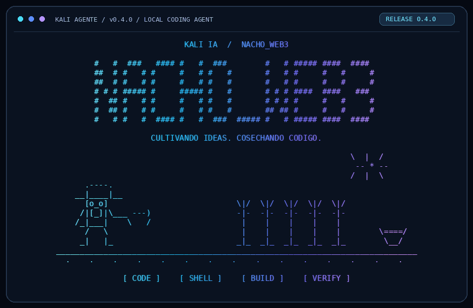

# Kali Agente · by nachoweb3



**A local coding agent built around OpenCode and Ollama, with Git worktrees and independent verification.** [Documentacion completa en espanol](README.md).

Inspect repositories, edit files, run shell commands and receive a report with the proposed patch. Choose your own Ollama tool-capable model. This package does not bundle model weights, OpenCode or Ollama. It is not a newly trained foundation model.

## Install

Requires Linux (or Windows through WSL2), Python 3.11+, Git, venv, pip, OpenCode and Ollama with an installed tool-capable model. Integration is tested against OpenCode 2.3.0. Ruff is optional. Project-specific dependencies must be installed separately in Linux.

```bash
git clone https://github.com/nachoweb3/kali-agente.git
cd kali-agente
bash scripts/install.sh
export PATH="$HOME/.local/bin:$PATH"
kali-agente configurar --modelo 'your-installed-model:latest'
kali-agente estado
kali-agente
```

For Windows, install prerequisites in WSL2, then run `powershell -NoProfile -ExecutionPolicy Bypass -File .\windows\install.ps1` from the clone. Reopen CMD or PowerShell and use `kali-agente.cmd`. The launcher preserves your current directory and runs the engine in Linux. Set `KALI_AGENT_WSL_DISTRO` if your distribution is not `kali-linux`. This is a WSL2 edition, not a native Windows implementation of Kali tools.

## Verified tasks

```bash
# Inside a clean Git repository with an initial commit:
kali-agente preparar
# Review and commit .kali-agente.json and AGENTS.md before proceeding.
kali-agente trabajar 'Fix the broken API endpoint' --segundos 1200 --acciones 60
kali-agente resultados
kali-agente retomar TASK_ID
```

The coordinator captures the original checks, creates a worktree, records baseline results, runs OpenCode, formats changed Python when Ruff is available and runs the original checks again. A corrective pass can use actual failures. Reports and patches stay under the local state directory. A verified status means the configured checks passed and the run ended normally; it is not proof of bug-free software. Changes are not merged automatically.

**Worktrees are not a sandbox.** The agent has the filesystem and network permissions of your account. `auto`, `trabajar`, `retomar` and `banco` automatically approve tools not explicitly denied by OpenCode. Protected-file checks detect changes after execution; they do not prevent writes. Use trusted projects and preferably a dedicated VM/account. Review [SECURITY.md](SECURITY.md).

Interactive mode asks for permissions according to OpenCode settings. `tarea 'goal'` runs a direct task; `auto 'goal'` enables automatic approval. Commands and agent instructions currently default to Spanish, but you can ask the model to respond in another language.

## Configuration

`kali-agente configurar --modelo MODEL --url http://127.0.0.1:11434 --contexto 16384 --salida 2048` writes this application's own config. `KALI_AGENT_MODEL`, `KALI_AGENT_OLLAMA_URL`, `KALI_AGENT_CONFIG_DIR`, `KALI_AGENT_STATE_DIR`, `KALI_AGENT_OPENCODE_BIN` and `KALI_AGENT_RUFF_BIN` override discovery. Standard XDG directories are respected. Existing OpenCode files are not overwritten; OpenCode can merge other configurations. Review its effective settings.

Inference uses the chosen Ollama endpoint. Tools, plugins and other configurations may connect to the network. Logs can contain private paths, prompts and command output; inspect before sharing. The coordinator adds no telemetry. Model quality, memory use and performance depend on your model and hardware.

## Development

Install `python -m pip install -e '.[dev]'` in a virtual environment. Run `python -m pytest -q`, `ruff format --check src tests scripts` and `python -m build`. Normal tests require no model or paid service. `kali-agente banco --caso todos` runs an optional small real-model benchmark; it is not a model leaderboard. `python scripts/render_banner.py` renders the terminal's exact ASCII frames as the README GIF using Pillow and a locally installed monospace font.

Our code and artwork are [MIT](LICENSE). External software and model licenses remain separate; see [THIRD_PARTY.md](THIRD_PARTY.md). Contributions welcome: [CONTRIBUTING.md](CONTRIBUTING.md).
