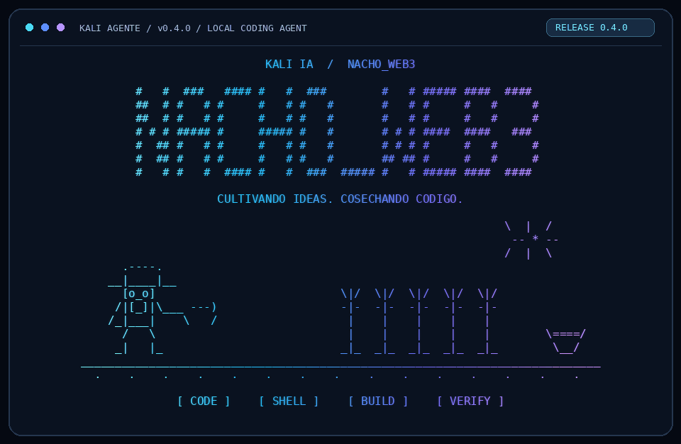
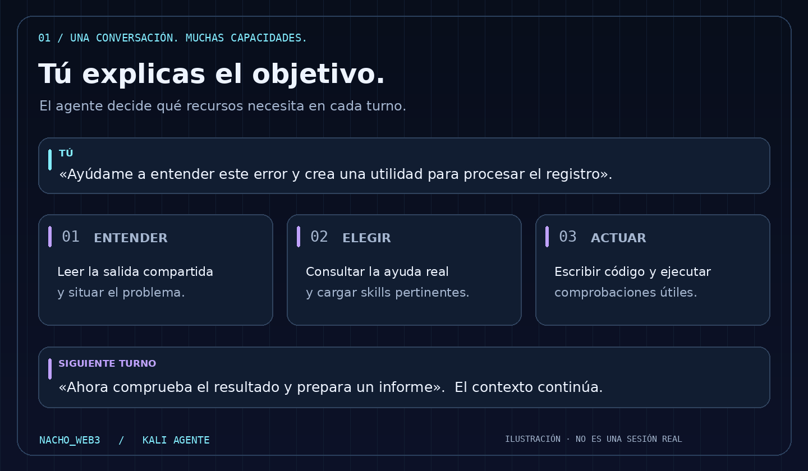
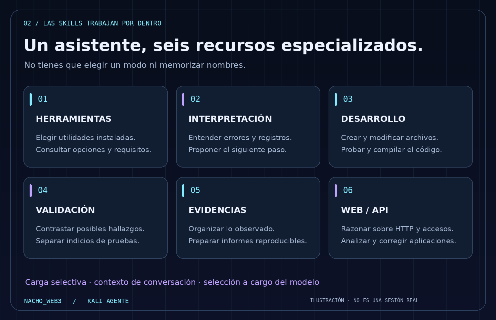
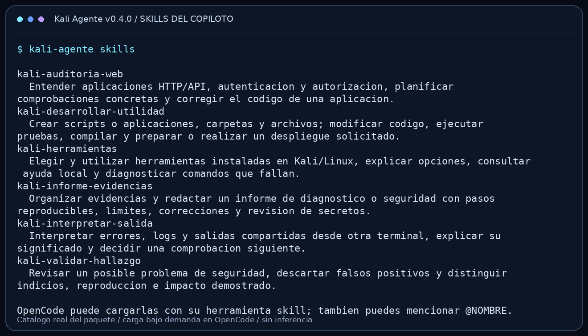
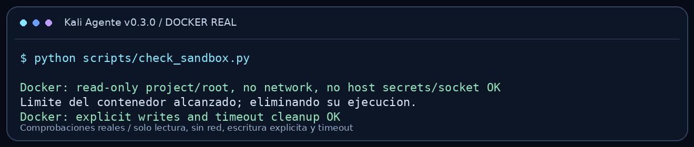
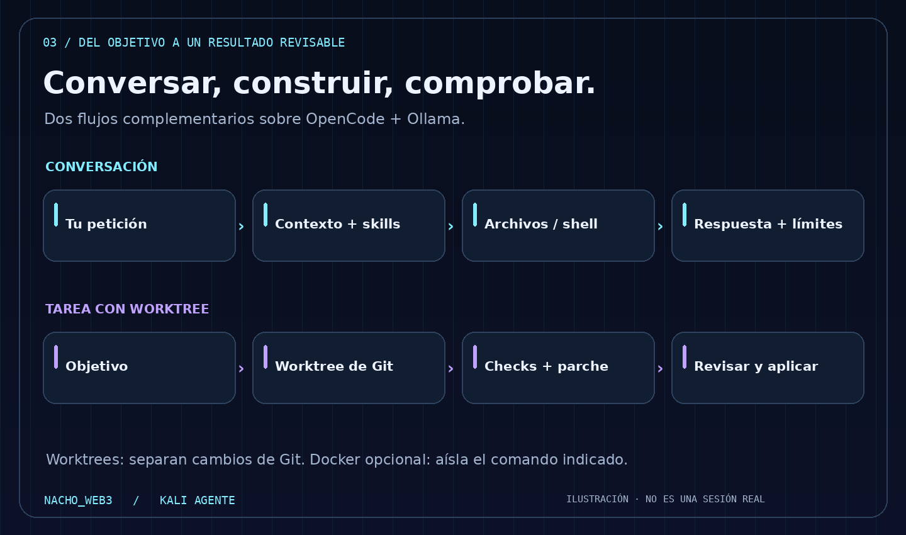
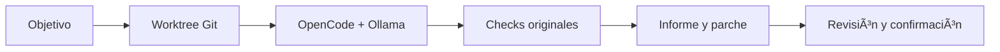

<div align="center">

# Kali Agente · v0.4.0

### Tu modelo local. Tu terminal. Cambios que puedes revisar.



[](https://github.com/nachoweb3/kali-agente/releases/tag/v0.4.0)
[](https://github.com/nachoweb3/kali-agente/actions/workflows/ci.yml)
[](LICENSE)
[](#instalacion)

**Un copiloto de ciberseguridad y programación local de [nachoweb3](https://github.com/nachoweb3), construido con OpenCode + Ollama.**

[Descargar v0.4.0](https://github.com/nachoweb3/kali-agente/releases/tag/v0.4.0) · [Capturas](#galeria) · [Instalación](#instalacion) · [Guía completa](docs/GUIA.es.md) · [English](README.en.md)

</div>

## Una conversación. Tu objetivo.

**Explica lo que necesitas con tus palabras.** El modelo interpreta cada petición en su contexto y elige los recursos pertinentes: herramientas, lectura de resultados, código o validación.



*Ilustración del flujo; no es una grabación del modelo ni representa tiempos reales.* [Alternativa estática](assets/story/conversation.png)

```bash
kali-agente
```

> «Explícame este error». Luego: «Lee este registro». Después: «Crea un script para procesarlo y comprueba el resultado».

No necesitas elegir skills ni memorizar subcomandos. Puedes pegar salidas o indicar archivos dentro del chat. [Cómo usar el copiloto →](docs/COPILOTO.md)

## Seis capacidades, una interfaz



Las skills se cargan bajo demanda. El agente puede trabajar con archivos y shell mediante OpenCode y sus permisos; sus decisiones dependen de la capacidad del modelo. Compilar y desplegar requiere herramientas, destino y acceso disponibles.

<p align="center">
<strong>Ollama local</strong> · <strong>Kali / Linux / WSL2</strong> · <strong>CMD y PowerShell</strong> · <strong>Parches revisables</strong>
</p>

Kali Agente también añade **worktrees de Git, comprobaciones independientes, límites de ejecución, informes y parches** alrededor de tu modelo local.

| Programar | Comprobar | Revisar |
| --- | --- | --- |
| Inspecciona el proyecto, crea archivos y ejecuta herramientas con OpenCode. | Conserva los checks originales y registra sus resultados antes y después. | Consulta el diff en terminal o HTML e integra con confirmación explícita. |

**Versión actual: 0.4.0** · Linux y Windows mediante WSL2 · Modelo configurable · Código propio bajo MIT.

<a id="galeria"></a>
## Así se ve

<details>
<summary><strong>Ver el catálogo interno de skills</strong></summary>



*Salida real del paquete; muestra el catalogo, sin simular respuestas del modelo.*

</details>

### Del fallo inicial al parche


*Salida del coordinador sobre un proyecto de demostración. El agente está simulado; Git y las comprobaciones se ejecutan realmente.*

### Revisión gráfica antes de integrar


*HTML generado por la herramienta para la misma demo, renderizado estáticamente. Muestra los checks y las líneas modificadas; la integración se confirma desde la terminal.*

<details>
<summary><strong>Ver aislamiento comprobado con Docker real</strong></summary>



*Prueba real del contenedor con una imagen local. No utiliza un modelo simulado ni ejecuta inferencia.*

</details>

<details>
<summary><strong>Ver la versión y los perfiles del modelo</strong></summary>


*Salidas reales de `--version` y `perfiles`, renderizadas como terminal.*

</details>

[Procedencia y regeneración de las capturas](docs/CAPTURAS.md) · [Ejemplo HTML descargable](assets/revision-demo.html)


La interfaz habitual es una unica conversacion: ejecuta `kali-agente` y escribe lo que necesitas con tus palabras. El modelo elige y combina capacidades en cada turno segun el contexto; no necesitas escribir IDs de skills, elegir categorias ni usar subcomandos para conversar. Puedes pegar una salida, pedir que lea un archivo, consultar una herramienta y despues encargar codigo en la misma sesion. Los comandos del manual son accesos opcionales para automatizacion y diagnostico. La seleccion depende del modelo y puede equivocarse; no garantiza comprension perfecta.

## Lo nuevo en v0.4.0

El modo principal ahora es un **copiloto para Kali y desarrollo de software**. Consulta herramientas instaladas, incorpora su ayuda real y analiza las salidas que compartas. Puede trabajar con archivos y shell mediante OpenCode, con los permisos configurados.

<details>
<summary><strong>Accesos opcionales para automatizacion y diagnostico</strong></summary>

| Capacidad | Uso |
| --- | --- |
| Inventario local | `kali-agente herramientas listar --todas`; 20 recetas de ayuda conocidas y deteccion de otros ejecutables. |
| Consultas precisas | `kali-agente copiloto --herramienta nmap "Explica -sV usando la ayuda local"` |
| Otra terminal | `registrar --salida sesion.log -- comando argumentos`; despues `copiloto --salida sesion.log "Explica este resultado"`. |
| Seis skills nativas | Herramientas, interpretacion, desarrollo, validacion, evidencias e informes, auditoria web. OpenCode las carga bajo demanda. |
| Cuadernos locales | Objetivo, alcance, scripts, evidencias y plantilla de informe separados por trabajo. |
| Desarrollo completo | Crear y modificar codigo, comprobarlo y compilarlo; desplegar requiere destino y acceso disponibles. |

```bash
kali-agente skills
kali-agente skills kali-herramientas
kali-agente copiloto "Crea una utilidad Python para resumir mis registros y prueba su funcionamiento"
```

</details>

[Manual del copiloto y las seis skills](docs/COPILOTO.md) · [Que adaptamos de Claude-BugHunter, fuentes y licencias](docs/CLAUDE-BUGHUNTER.md)

Las skills y fichas adaptadas de Sachin Sharma / elementalsouls conservan **CC BY 4.0**; el codigo propio es MIT. No se instalan plugins ni motores externos. La integracion nativa se ha verificado con OpenCode real y un modelo simulado; eso no demuestra que cualquier modelo seleccione bien todas las skills. Una consulta real a Nmap con el modelo local tardo **117 segundos en CPU**. Las evaluaciones anteriores del modelo siguen siendo limitadas y no se convierten en resultados mejores por incorporar estas guias.

Conserva Docker opcional, seis casos de evaluacion, perfiles reproducibles, worktrees, revision HTML y gestion de tareas de v0.3.0. [Historial](CHANGELOG.md).

## Cómo trabaja



El chat es la entrada habitual. Para tareas con cambios separados en Git y comprobaciones independientes existe el flujo adicional de worktrees.

<details>
<summary><strong>Ver el diagrama técnico y los comandos del flujo con worktree</strong></summary>



```bash
kali-agente iniciar
kali-agente preparar
# Revisa y versiona la configuración del proyecto antes de trabajar.
kali-agente trabajar "Corrige el error del endpoint de usuarios"
kali-agente tareas --seguir
kali-agente revisar ID --grafico
kali-agente aplicar ID
```

`aplicar` requiere una terminal interactiva. Comprueba de nuevo el estado y los checks, prepara los cambios en Git y **no crea un commit**. [Flujo completo y requisitos →](docs/GUIA.es.md#del-objetivo-al-parche)

</details>

<a id="instalacion"></a>
## Empieza aquí

Necesitas **Python 3.11+, Git, OpenCode y Ollama**, con un modelo compatible con herramientas ya instalado. La integración está probada con OpenCode 2.3.0. El instalador no descarga modelos.

**Linux / Kali / WSL2**

```bash
git clone https://github.com/nachoweb3/kali-agente.git
cd kali-agente
bash scripts/install.sh
export PATH="$HOME/.local/bin:$PATH"
kali-agente iniciar
```

**Windows · CMD y PowerShell**

Descarga y extrae el [ZIP de Windows / WSL2 v0.4.0](https://github.com/nachoweb3/kali-agente/releases/download/v0.4.0/kali-agente-0.4.0-windows-wsl2.zip). Desde la carpeta extraída:

```powershell
powershell -NoProfile -ExecutionPolicy Bypass -File .\windows\install.ps1
```

El motor corre dentro de WSL2. La distribución predeterminada es `kali-linux`; puedes escoger otra instalada. [Preparar Windows y configurar Ollama →](docs/GUIA.es.md#windows-cmd-y-powershell)

## Evidencias y límites

- **63 pruebas automáticas**, más 9 subtests de fixtures y validadores, aprobadas en la validación local de v0.4.0.
- **CI para Python 3.11, 3.12, 3.13 y 3.14**, scripts de Windows y prueba real de Docker. [Consultar Actions](https://github.com/nachoweb3/kali-agente/actions/workflows/ci.yml).
- **Wheel instalado en un entorno independiente**, flujo de revisión/integración y parámetros enviados por OpenCode comprobados. [Detalle de validación](VALIDATION.md).
- **Evaluación del modelo publicada por separado:** 0/3 casos nuevos verificados en la ejecución local de CPU con 180 segundos por tarea. No se confunde ese resultado con los tests del coordinador. [Condiciones y resultados](evaluations/README.md).

**Los worktrees separan cambios de Git; no aíslan el shell.** El comando opcional `aislado` contiene solo la herramienta que ejecutes mediante él. Los modos automáticos tienen acceso real a tu cuenta y los contenedores comparten kernel. Consulta [seguridad y alcance](SECURITY.md).

## Documentación y comunidad

| Quiero… | Ir a… |
| --- | --- |
| Instalar, configurar modelos y aprender los comandos | [Guía completa en español](docs/GUIA.es.md) |
| Read the installation and command guide in English | [English guide](docs/GUIDE.en.md) |
| Ver cómo se hicieron las imágenes | [Arte y capturas reproducibles](docs/CAPTURAS.md) |
| Repetir una evaluación | [Casos, manifiestos y resultados](evaluations/README.md) |
| Proponer una mejora o reportar un problema | [Issues](https://github.com/nachoweb3/kali-agente/issues) · [Discussions](https://github.com/nachoweb3/kali-agente/discussions) |
| Contribuir código | [CONTRIBUTING.md](CONTRIBUTING.md) |

---

<div align="center">

**Creado por [nachoweb3](https://github.com/nachoweb3)** · Cultivando ideas. Cosechando código.

[Código y arte propios: MIT](LICENSE) · [Licencias de componentes externos](THIRD_PARTY.md) · [Descargas](https://github.com/nachoweb3/kali-agente/releases)

</div>
